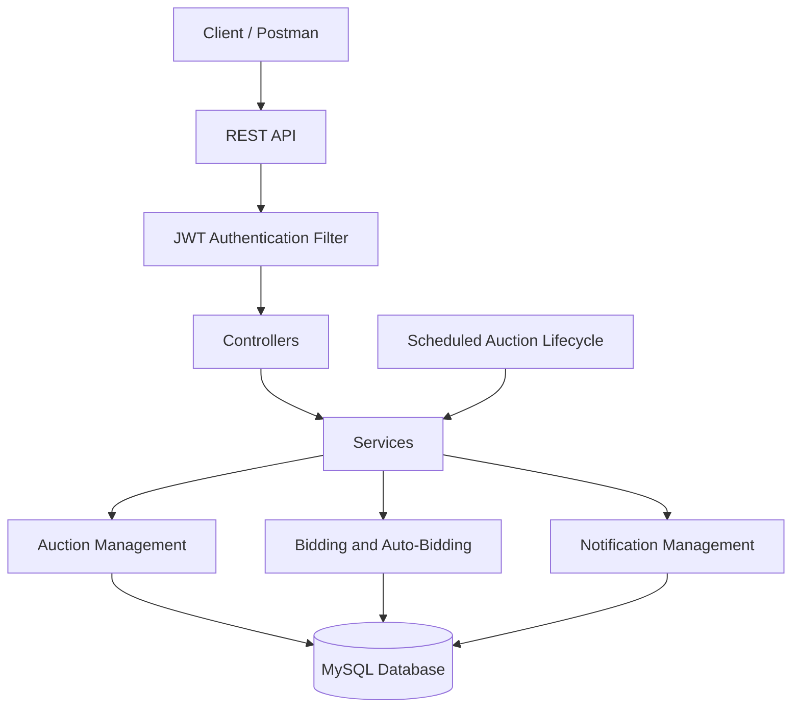
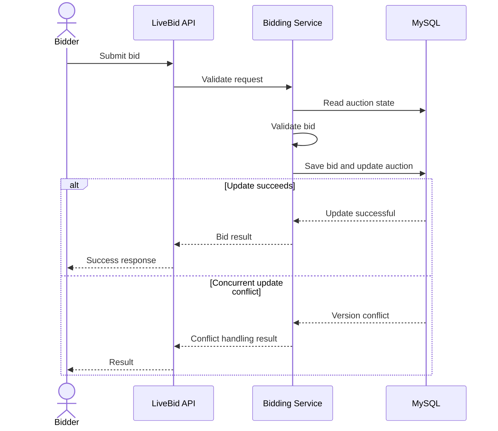

# 🔨 LiveBid — Online Auction System

<p align="center">
  <strong>A Java 21 and Spring Boot backend for secure online auctions, concurrent bidding, automatic bidding, and auction lifecycle management.</strong>
</p>

<p align="center">
  
  
  
  
  
</p>

<p align="center">
  <a href="#-overview">Overview</a> •
  <a href="#-features">Features</a> •
  <a href="#-architecture">Architecture</a> •
  <a href="#-api-reference">API Reference</a> •
  <a href="#-getting-started">Getting Started</a> •
  <a href="#-testing">Testing</a>
</p>

---

## 📌 Overview

**LiveBid** is a backend application for managing online auctions. It exposes REST APIs that allow authenticated users to browse auctions, create auctions, place bids, configure automatic bidding, and retrieve notifications.

The application uses JWT-based authentication to protect endpoints and optimistic locking to detect conflicting updates when multiple users compete to place bids. A scheduled service manages auction lifecycle transitions and winner notifications.

### 🎯 Project Objectives

- Develop a modular Java backend for an online auction platform.
- Implement authenticated access using JWT.
- Maintain auction consistency during concurrent bidding.
- Support automatic bidding within user-defined limits.
- Automate auction lifecycle transitions and notifications.

## ✨ Features

<details>
<summary><strong>🔐 Authentication and Security</strong></summary>

- User registration and login APIs.
- JWT-based authentication for protected endpoints.
- Password hashing using BCrypt.
- User-specific operations based on the authenticated identity.

</details>

<details>
<summary><strong>🔨 Auction Management</strong></summary>

- Retrieve all auctions and individual auction details.
- Create auctions.
- Track the current highest bid and bidder.
- Manage scheduled, live, and closed auction states.

</details>

<details>
<summary><strong>💰 Bidding and Concurrency</strong></summary>

- Submit bids against an auction.
- Retrieve bid history.
- Track the current highest bid.
- Use optimistic locking to detect concurrent update conflicts.

**Why this matters:** Concurrent bidding introduces a race condition when multiple requests attempt to update the same auction. Optimistic locking helps detect conflicting updates and protects data consistency.

</details>

<details>
<summary><strong>🤖 Automatic Bidding</strong></summary>

- Configure an automatic bidding limit.
- Submit eligible bids on behalf of a user.
- Deactivate an automatic bidding configuration.
- Identify automatically placed bids.

</details>

<details>
<summary><strong>🔔 Notifications and Auction Lifecycle</strong></summary>

- Retrieve notifications for the authenticated user.
- Generate outbid notifications.
- Notify the winning bidder when an auction closes.
- Periodically evaluate scheduled and live auctions.

</details>

## 🛠️ Technology Stack

| Technology | Purpose |
|---|---|
| Java 21 | Core programming language |
| Spring Boot | Backend application framework |
| Spring Security | Endpoint security |
| JWT | Token-based authentication |
| BCrypt | Password hashing |
| MySQL | Relational database |
| Spring Data JPA / JDBC | Persistence and database access, as implemented |
| Maven | Dependency management and build |
| Postman | API testing |
| IntelliJ IDEA | Development environment |

## 🏗️ Architecture

The application separates request handling, business logic, database access, authentication, and domain models into distinct packages.



### 🔄 Concurrent Bidding Workflow



*The diagram illustrates the conceptual workflow. Exact transaction boundaries and retry behavior depend on the implementation.*

## 🔌 API Reference

**Base URL:** `http://localhost:8080`

Protected endpoints require a valid JWT unless otherwise configured in the application security settings.

### Authentication

| Method | Endpoint | Description |
|---|---|---|
| `POST` | `/api/auth/register` | Register a user |
| `POST` | `/api/auth/login` | Authenticate a user |

### Auctions and Bids

| Method | Endpoint | Description |
|---|---|---|
| `GET` | `/api/auctions` | Retrieve auctions |
| `GET` | `/api/auctions/{id}` | Retrieve auction details |
| `POST` | `/api/auctions` | Create an auction |
| `POST` | `/api/auctions/{auctionId}/bids` | Place a bid |
| `GET` | `/api/auctions/{auctionId}/bids` | Retrieve bid history |

### Automatic Bidding

| Method | Endpoint | Description |
|---|---|---|
| `POST` | `/api/auctions/{auctionId}/auto-bid` | Configure automatic bidding |
| `DELETE` | `/api/auctions/{auctionId}/auto-bid` | Deactivate automatic bidding |

### Notifications

| Method | Endpoint | Description |
|---|---|---|
| `GET` | `/api/users/me/notifications` | Retrieve notifications for the authenticated user |

<details>
<summary><strong>📨 Example: Configure Automatic Bidding</strong></summary>

**Request**

```http
POST /api/auctions/9/auto-bid
Authorization: Bearer YOUR_JWT_TOKEN
Content-Type: application/json
```

**Request body**

```json
{
  "maxAmount": 4000.00
}
```

Replace the example auction ID and token with valid values from your local application. The maximum amount is the user's configured automatic bidding limit.

</details>

<details>
<summary><strong>🔔 Example: Retrieve Notifications</strong></summary>

**Request**

```http
GET /api/users/me/notifications
Authorization: Bearer YOUR_JWT_TOKEN
```

This endpoint retrieves notifications for the authenticated user.

</details>

> **Note:** For exact bid creation, auction creation, registration, and login request examples, refer to the request DTOs in the source code. Use the fields defined by the application rather than assuming a generic request format.

## 🚀 Getting Started

### Prerequisites

Install the following before running the application:

- Java Development Kit (JDK) 21
- MySQL Server
- Git
- IntelliJ IDEA or another Java IDE
- Postman for API testing

### 1. Clone the Repository

```bash
git clone https://github.com/sujithakrishna/livebid-springboot-auction-system.git
cd livebid-springboot-auction-system
```

### 2. Create the Database

Open MySQL Workbench or your preferred MySQL client and execute:

```sql
CREATE DATABASE livebid_db;
```

The application must be configured to connect to this database. Ensure the required tables are created through the project's entity mappings or database initialization configuration.

### 3. Configure Environment Variables

The application configuration uses environment variables for database credentials and the JWT signing secret.

| Variable | Purpose |
|---|---|
| `DB_URL` | MySQL JDBC connection URL |
| `DB_USERNAME` | MySQL username |
| `DB_PASSWORD` | MySQL password |
| `JWT_SECRET` | JWT signing secret |

Example values for a local development environment:

```text
DB_URL=jdbc:mysql://localhost:3306/livebid_db
DB_USERNAME=your_mysql_username
DB_PASSWORD=your_mysql_password
JWT_SECRET=your_generated_secret
```

Set these as environment variables on your machine or in your IDE's run configuration. The example values above are placeholders, not literal credentials.

**Security guidelines**

- Never commit real passwords or JWT signing secrets.
- Do not publish a `.env` file containing credentials.
- Use a strong, randomly generated JWT secret.
- Rotate any secret that has been exposed.

### 4. Run the Application

Open the cloned project in IntelliJ IDEA and allow Maven to resolve its dependencies.

You can run the main application class:

```text
com.sujitha.livebidspringboot.LivebidSpringbootApplication
```

Alternatively, on Windows PowerShell, run the Maven wrapper:

```powershell
.\mvnw.cmd spring-boot:run
```

The default local API base URL is:

```text
http://localhost:8080
```

### 5. Test with Postman

1. Register a user.
2. Log in and obtain a JWT.
3. Set the token as a Bearer Token for protected requests.
4. Create or select an auction.
5. Place bids and inspect the auction's bid history.
6. Test automatic bidding.
7. Retrieve notifications for the authenticated user.
8. Verify auction lifecycle transitions.

## 🧪 Testing

The repository includes Java test source files under `src/test`.

### Recommended Verification Checklist

Use this checklist to track testing as you verify each scenario.

- [ ] User registration and login
- [ ] JWT authentication for protected endpoints
- [ ] Auction creation and retrieval
- [ ] Valid and invalid bid requests
- [ ] Bid history retrieval
- [ ] Concurrent bidding and optimistic-lock conflict handling
- [ ] Automatic bidding within the configured limit
- [ ] Automatic bidding deactivation and ownership validation
- [ ] User-specific notification retrieval
- [ ] Scheduled auction transitions and winner notifications

Only mark a scenario as complete after confirming its result.

## 📂 Project Structure

```text
livebid-springboot-auction-system/
├── .mvn/
├── src/
│   ├── main/
│   │   ├── java/com/sujitha/livebidspringboot/
│   │   │   ├── config/
│   │   │   ├── controller/
│   │   │   ├── dao/
│   │   │   ├── dto/
│   │   │   ├── exception/
│   │   │   ├── model/
│   │   │   ├── security/
│   │   │   ├── service/
│   │   │   └── LivebidSpringbootApplication.java
│   │   └── resources/
│   │       └── application.properties
│   └── test/java/com/sujitha/livebidspringboot/
├── .gitignore
├── mvnw
├── mvnw.cmd
├── pom.xml
└── README.md
```

## 💡 Engineering Highlights

- **Concurrency control:** Optimistic locking helps detect conflicting updates to an auction.
- **Authentication:** JWT-based authentication protects restricted API operations.
- **Password security:** BCrypt is used to hash passwords.
- **Automated bidding:** User-defined limits support automatic bid placement.
- **Scheduled processing:** Auction lifecycle transitions are handled by a scheduled service.
- **User-specific notifications:** Notification retrieval is scoped to the authenticated user.

## 🛣️ Future Improvements

- Expand automated unit and integration test coverage.
- Add API documentation using OpenAPI/Swagger if configured.
- Add deployment instructions and production environment configuration.
- Add structured logging and monitoring.
- Add a frontend for bidders and auction administrators.
- Add real-time bid updates through a WebSocket client if supported by the application.

## 👩‍💻 Author

**Sujitha V K**

- GitHub: [@sujithakrishna](https://github.com/sujithakrishna)
- LinkedIn: [Connect on LinkedIn](https://www.linkedin.com/in/sujitha-v-k-77a924258/)

---

<p align="center">
  <strong>LiveBid — Building reliable bidding workflows with Java and Spring Boot.</strong>
</p>
